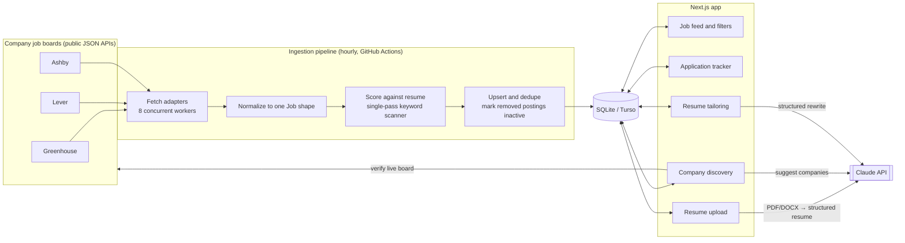
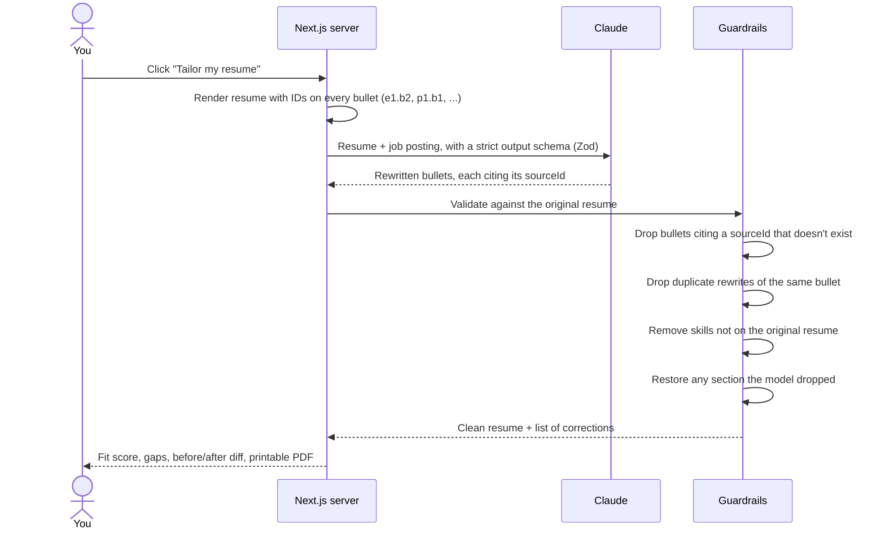
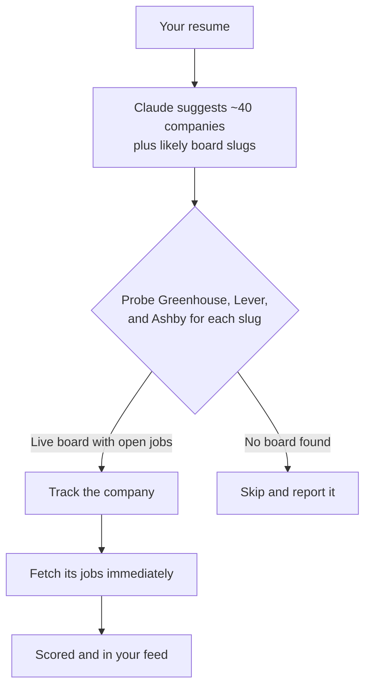

# Job Hunter

**Live jobs straight from company job boards, ranked against your resume, with AI resume tailoring that can't invent experience.**

Job Hunter pulls thousands of live postings directly from the job boards companies use (Greenhouse, Lever, and Ashby), scores every one against your resume, and uses Claude to rewrite your resume for a specific job. Every AI-written line has to trace back to something you actually wrote.

    [](https://github.com/dururaph/job-hunter/actions/workflows/ci.yml)

---

## The problem

Job hunting has three expensive steps, and most tools handle only one of them:

1. **Finding real, current openings.** Aggregators like LinkedIn and Indeed are full of reposts, expired listings, and "promoted" noise. The source of truth is each company's own job board, but checking dozens of career pages by hand doesn't scale.
2. **Knowing which jobs are worth your time.** Reading 8,000 descriptions to find the 50 that fit you isn't realistic.
3. **Tailoring your resume for each application.** It works, but it takes 20–30 minutes per job. AI tools speed this up, but they tend to *make things up*: invented metrics, skills you don't have, inflated titles. That can cost you the offer.

## The solution

| Step | How Job Hunter handles it |
|---|---|
| Finding jobs | Pulls **~8,000 live postings from 35+ companies** every hour, straight from the boards' public JSON APIs. No scraping, no stale reposts. |
| Ranking | Scores every job against your skills **locally, in under a second, for free** (no AI calls). Filter by remote, seniority, date posted, and your target roles. |
| Finding companies | Claude reads your resume and suggests companies that hire for your profile. Each suggestion is **checked against the live job boards** before it's added. |
| Tailoring | Claude rewrites and reorders your bullets for the posting. **Guardrails reject any bullet that doesn't trace to your original resume** and any skill you never listed. You review a side-by-side diff, then export a clean PDF. |
| Tracking | Each job moves through new → saved → applied → interviewing → rejected. |

---

## How it works

### System architecture



### Resume tailoring flow (with anti-fabrication guardrails)



### Company discovery flow



---

## Engineering challenges and how I solved them

| # | Problem | Solution | Result |
|---|---|---|---|
| 1 | **LLMs fabricate resume content.** Models add metrics, tools, or responsibilities that sound right but aren't true. | Each original bullet gets a stable ID. The model must return structured output where every bullet cites a `sourceId`. A deterministic validator then drops anything that doesn't trace back, removes unlisted skills, and restores dropped sections. | Fabricated content is caught by code, not by trusting the prompt. Corrections are shown to you. Covered by unit tests. |
| 2 | **Three job boards, three different data shapes.** Different field names, date formats, location formats, and salary structures. | An adapter per board behind one `Fetcher` interface, all normalizing to a single `NormalizedJob` type. | Adding a new board means writing one small file. Nothing else changes. |
| 3 | **Greenhouse returns double-encoded HTML** (`&lt;p&gt;...&amp;amp;...`), which rendered as garbage. | A sanitizer that detects entity-encoded markup, decodes it, strips tags, and keeps list and paragraph structure. | Clean, readable descriptions from every board. |
| 4 | **Match scoring was too slow:** 5.5 s to re-score 8,000 jobs, because 150+ skills each ran their own regex over every description. | Compiled the vocabulary into two combined regexes (case-sensitive and case-insensitive, longest match first) so each document is scanned once. | **11× faster (5.5 s → 0.5 s)**, so re-scoring after a resume edit feels instant. |
| 5 | **False skill matches from everyday words:** "go further", "you excel at", "swiftly". | Ambiguous skill names (Go, Excel, Swift, Rust, Spring, …) only match when capitalized, and boundary lookarounds handle `C++`, `C#`, `.NET`, and `CI/CD`. | Tested: a sales posting full of those words matches zero skills. |
| 6 | **Keeping data fresh without duplicates or losing your progress.** | Deterministic IDs (`source:company:postingId`) with upsert-on-conflict that refreshes posting fields but never overwrites your status. Postings missing from a board's latest response are marked inactive. | Re-running ingestion adds 0 duplicates, and your applied/saved statuses survive every refresh. |
| 7 | **AI-suggested companies may not exist on these boards,** or the guessed slug is wrong. | Every suggestion is probed against all three boards' lightweight endpoints. Only boards with live postings are added. | No dead companies in your list. |
| 8 | **Hourly refreshes rewrote every row,** about 6M database writes a month, enough to exhaust a free tier. | Each posting stores a content hash. Ingestion writes only new, edited, or removed postings, and purges postings gone for 30+ days that you never acted on. | **Steady-state writes dropped from 8,356 rows per run to 0** (runs went from 10 s to 4 s). |
| 9 | **A personal app on the public internet** exposes your resume and your API credit. | A password gate (`APP_PASSWORD`) enforced in the Next.js proxy for every page, re-checked inside every Server Action, with a hashed httpOnly session cookie and constant-time comparison. | Only you can view data or trigger paid AI calls. |
| 10 | **Keeping it free to run at scale.** | Scoring runs locally. Claude is called only on explicit actions (upload, discover, tailor) using Claude Haiku 5.5. Fetching runs on GitHub Actions, the database on Turso's free tier, hosting on Vercel. | About $0 per month for infrastructure, and a fraction of a cent per tailored resume. |

---

## Why it doesn't auto-apply

This is a deliberate design decision:

- **The APIs are read-only.** Greenhouse, Lever, and Ashby let anyone *read* job listings, but submitting an application through their APIs requires the **employer's** private API key. The only way to auto-apply is a bot that fills in web forms, which runs into CAPTCHAs, custom screening questions, and file-upload widgets that differ on every site.
- **It breaks the rules and can hurt you.** Automated submissions usually violate the boards' terms of service, and recruiters and ATS systems flag mass-applied candidates. A bot can also answer screening questions wrongly or submit the wrong resume under your name.
- **Quality wins.** Ten tailored applications outperform 200 generic ones. Job Hunter makes the *right* application take about two minutes instead of thirty.

---

## Tech stack

| Layer | Choice | Why |
|---|---|---|
| Framework | **Next.js 16** (App Router, Server Actions, Cache Components) | One TypeScript codebase for UI and backend; deploys free on Vercel |
| Database | **SQLite via libSQL** with **Drizzle ORM** | A local file in development, Turso in production, with no code changes |
| AI | **Claude Haiku 5.5** via the Anthropic SDK, with Zod structured outputs | Schema-validated responses; the cheapest model that does the job (configurable) |
| Scheduling | **GitHub Actions** cron | Free, and has no serverless timeout limits |
| Styling | **Tailwind CSS 4** | Light and dark mode, plus a print stylesheet for PDF export |
| Testing | Node test runner + `tsx` | Guardrails, matcher, and parser tests |

## Project structure

```
src/
├── app/
│   ├── page.tsx                 # Job feed with filters and pagination
│   ├── jobs/[id]/               # Job detail and "Tailor my resume"
│   ├── tailored/[id]/           # Fit analysis, diff, printable resume
│   ├── resume/                  # Upload and edit your resume
│   ├── companies/               # Discover, add, and remove companies
│   ├── api/ingest/route.ts      # Cron endpoint (optional alternative to GitHub Actions)
│   └── actions.ts               # Server Actions
├── lib/
│   ├── sources/                 # Greenhouse, Lever, and Ashby adapters
│   ├── ingest.ts                # Concurrent fetch, upsert, stale detection
│   ├── match.ts                 # Single-pass keyword scanner and scoring
│   ├── tailor.ts                # Claude call and anti-fabrication guardrails
│   ├── parse-resume.ts          # PDF/DOCX/TXT → structured resume
│   ├── discover.ts              # AI company suggestions, verified against live boards
│   └── companies.ts             # Board probing and the company list
└── db/schema.ts                 # Jobs, companies, profile, tailored resumes, ingest runs
scripts/ingest.ts                # CLI ingestion (used by GitHub Actions)
tests/core.test.ts               # Unit tests
```

---

## Getting started

### 1. Install and run

```bash
git clone https://github.com/dururaph/job-hunter.git
cd job-hunter
npm install
cp .env.example .env.local     # then add your API key (step 2)
npm run db:push                # create the local database
npm run ingest                 # fetch live jobs (~15 s)
npm run dev                    # open http://localhost:3000
```

### 2. Add a Claude API key

Uploading, company discovery, and tailoring use Claude. Browsing, scoring, filtering, and tracking work without a key.

1. Create an account at [console.anthropic.com](https://console.anthropic.com) and add credit under **Billing** ($5 lasts a long time on Haiku).
2. Go to **API Keys** → **Create Key** and copy it (it starts with `sk-ant-`).
3. In `.env.local`, set `ANTHROPIC_API_KEY=sk-ant-...` (no quotes).
4. Restart `npm run dev`.

`.env.local` is git-ignored, so your key is never committed.

### 3. Use it

1. **Resume:** upload your resume (PDF, DOCX, or TXT). Every job is re-scored against it.
2. **Companies:** click *Find companies from my resume*, or add any company by name or careers URL.
3. **Jobs:** filter, open a posting, click *Tailor my resume*, review the diff, and click *Download PDF*.
4. **Tracker:** move jobs through saved → applied → interviewing.

## Deploying for free

1. **Database:** create a free [Turso](https://turso.tech) database, set `DATABASE_URL` and `DATABASE_AUTH_TOKEN`, then run `npm run db:push`.
2. **App:** import the repo into [Vercel](https://vercel.com) and add `DATABASE_URL`, `DATABASE_AUTH_TOKEN`, `ANTHROPIC_API_KEY`, and **`APP_PASSWORD`** (a long, unique password; this locks the site so only you can use it) as environment variables.
3. **Hourly refresh:** add `DATABASE_URL` and `DATABASE_AUTH_TOKEN` as GitHub Actions secrets. The workflow in `.github/workflows/ingest.yml` runs every hour.

### Cost

| Service | Role | Cost |
|---|---|---|
| Vercel (Hobby) | Hosting | $0 |
| Turso (free tier) | Database | $0 (only changed rows are written) |
| GitHub Actions | Hourly fetch and CI | $0 for public repos |
| Claude Haiku 5.5 | Upload, discovery, tailoring | About $0.003 per tailored resume |

### Good to know

- Resume uploads are capped at 4 MB (Vercel limits request bodies to 4.5 MB).
- GitHub pauses scheduled workflows on repos with no commits for 60 days. Re-enable it from the Actions tab.
- Set a monthly spend limit in the Anthropic Console as a safety net.

## Scripts

| Command | Purpose |
|---|---|
| `npm run dev` | Start the app |
| `npm run ingest` | Fetch every tracked board now |
| `npm run db:push` | Create or update database tables |
| `npm test` | Run unit tests |
| `npm run typecheck` | Type-check the project |

## Roadmap

- [ ] Email or Discord alerts for new high-match jobs
- [ ] AI-drafted answers to common application questions and cover letters
- [ ] More boards (Workable, SmartRecruiters, Recruitee)
- [ ] Application analytics (response rate by company, role, and match score)
